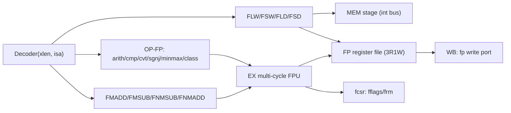

# 浮点扩展（F / D）— 技术设计

Feature Name: fp-extension
Updated: 2026-09-22

## Description

在单发射按序五级流水线上实现 F/D。新增独立浮点寄存器堆（32×FLEN）、`fcsr`（`fflags`/`frm`）与 `mstatus.FS`；译码层识别浮点访存（`0000111`/`0100111`）、OP-FP（`1010011`）与 FMA（`1000011`/`1000111`/`1001011`/`1001111`）编码；EX 段新增一个多周期 IEEE-754 浮点单元（FPU），复用既有 `freezeAll` 冻结流水线在若干拍内产出结果，经既有旁路/回写通路送回浮点寄存器堆。浮点访存复用整数 load/store 通路（整数基址 + 浮点数据寄存器）。F/D 关闭时全部新增逻辑为空。

**范围**：先实现 F（FLEN=32）并回归，随后把参数化 FPU 扩为 D（FLEN=64，仅 RV64）。

## Architecture

## Components and Interfaces

### 配置层（`isa/RvExtension.scala`、`isa/IsaConfig.scala`、`CoreConfig.scala`）

- `RvExtension.SingleFloat` / `DoubleFloat` 从 `reserved` 移入 `implemented`（`implemented = {M, A, F, D, Zicsr, C}`）。
- 结构规则：D 蕴含 F（`IsaConfig` 构造时 `require`）；D 仅允许 `xlen=64`。
- `IsaConfig.rv32f`/`rv64f`（F）、`rv64d`（D）与对应 `CoreConfig` 工厂；`CoreConfig` 转发 `hasFloat/hasDouble/flen`。
- `flen = if (hasDouble) 64 else if (hasFloat) 32 else 0`。
- `misa`：F 置 `F` 位，D 同时置 `F`/`D` 位。

### FP 寄存器堆（`core/FpRegisterFile.scala`）

- `Vec(Reg(Bits(flen bits)), 32)`，3 读端口（`rs1/rs2/rs3`）+ 1 写端口。
- 写端口由 WB 驱动（浮点指令的 `rd`）；读端口供 EX 取浮点操作数。
- 调试读出口 `debugFregs`（可选，随 `withDebug`）。

### CSR（`isa/CsrMap.scala`、`core/CsrFile.scala`）

- 新增 `fflags(0x001)`、`frm(0x002)`、`fcsr(0x003)`，`minPriv=U`（M/U 可见）。
- `fcsrReg[7:0]` 存储：`fflags=fcsr[4:0]`、`frm=fcsr[7:5]`；写 `fcsr` 整体覆盖低 8 位；写 `fflags`/`frm` 按掩码更新。
- `mstatus.FS`（13:14）纳入 `mstatusMask`（WARL，可写）。复位 `FS=Off(0)`。
- FP 指令提交时（写浮点寄存器或写浮点 CSR）`FS<-Dirty(11)`；`FS=Off` 由 EX 判 illegal（见下）。

### Decoder（`core/Decoder.scala`）

`DecodeOutput` 新增字段：

- `fp = Bool()`：该指令属于浮点通路（访存/OP-FP/FMA）。
- `fpWrite = Bool()`：写浮点寄存器堆（`FLW/FLD`、计算/转换/mv 结果）。
- `fpRead3 = Bool()`：FMA 需要第三读端口。
- `fpLoad = Bool()` / `fpStore = Bool()`：浮点访存方向。
- `fpOp = UInt(...)`：FPU 操作选择（见 FPU）。
- `fpRm = UInt(3 bits)`：实际舍入模式（指令 `rm` 或动态读 `frm`，动态=111 时取 `frm`；`frm` 保留或指令 rm 保留→illegal）。
- `fpFmt = Bool()`：0=单精度，1=双精度。
- `fpWidth`/转换目标宽度由 `fpOp` 与 `rs2` 编码承载。
- `fpIntRd = Bool()`：结果写整数寄存器堆（`FCLASS`/`FCMP`/`FMV.X`/`FCVT.*.W/FCVT.*.L`）。

**FP 访存**：`FLW/FLD` 复用整数 load 通路（`memRead`, `memSize=2/3`, `wbSel=MEM`），但写回目标是浮点堆；`FSW/FSD` 复用 store 通路，数据源为浮点 `rs2` 读口。

**OP-FP（1010011）**：按 `funct7` 分派（低 2 位为 fmt）：

| funct7[6:2] | 指令 | 说明 |
|-------------|------|------|
| 00000 | FADD | fmt 由 [1:0]（00=S / 01=D） |
| 00001 | FSUB | |
| 00010 | FMUL | |
| 00011 | FDIV | |
| 01011 | FSQRT | rs2=0 |
| 00100 | FSGNJ/N/X | funct3=000/001/010 |
| 00101 | FMIN/MAX | funct3=000/001 |
| 01000 | FCVT.S.D / FCVT.D.S | [1:0]=00→S.D，01→D.S |
| 10100 | FEQ/FLT/FLE | funct3=010/001/000，写整数 |
| 11000 | FCVT.<int>.<fmt> | rs2 选宽度，写整数 |
| 11010 | FCVT.<fmt>.<int> | rs2 选宽度，写浮点 |
| 11100 | FMV/FCLASS | funct3=000 FMV，001 FCLASS |

**FMA（1000011/1000111/1001011/1001111）**：`fmt=instr[26:25]`，`rs3=instr[31:27]`，`funct3=rm`。

**非法**：F/D 关闭、`FS=Off`、保留 `rm`/`frm`、保留编码、RV32 上 D 形式、`FCVT.L/LU` 在 xlen=32、`FLD/FSD` 在无 D 配置 → illegal（cause 2）。

### FPU（`core/FpUnit.scala`）

参数化 `flen`/`expw`/`sigw` 的多周期单元，接口：`op`、`rm`、`a/b/c`（FLEN 位操作数）、`start`、`done`、`result`、`flags`。

- **展开/规格化**：把输入拆为 `sign/exp/sig`；识别 NaN（含 NaN-boxing：FLEN=64 且高 32 位非全 1 的单精度视为规范 NaN）、±Inf、±0、次正规。
- **工作精度**：有效位 `p = sigw+1`，内部保留 `p+3` 位（implicit + fraction + G/R/S）。
- **加减**：对齐（小阶右移，移出位并入 sticky）→ 加/减 → 规格化 → 舍入。
- **乘**：`p×p` 组合乘法 → 规格化 → 舍入。
- **除/开方**：多周期恢复型算法，产出商/根的位与余数（决定 sticky）→ 舍入。
- **FMA**：先做无舍入全宽乘法，再对齐被加数到乘积指数并加 → 规格化 → 舍入（一次舍入）。
- **舍入**：由 `rm` + G/R/S 统一实现 RNE/RTZ/RDN/RUP/RMM。
- **标志**：按运算与事件生成 `NV/DZ/OF/UF/NX`，累积写回 `fflags`。
- **控制**：`start` 后进入多周期 FSM；`done` 时输出结果与标志，并由核将其写入浮点堆与 `fflags`。

### RiscvCore（`RiscvCore.scala`）

- 新增 `FpRegisterFile` 与 `FpUnit`（仅 `withFloat` 时实例化）。
- 流水线 bundle 增加浮点控制/数据字段（`fp`、`fpWrite`、`fpOp`、`fpRm`、`fpFmt`、`fpIntRd`、`fpNew` 等）。
- **旁路**：浮点寄存器堆独立旁路网络；多周期 FPU 忙时 `fpStall` 并入 `freezeAll`；结果经 WB 浮点写端口提交。
- **访存**：`FLW/FLD` 结果从 `dBus.readData` 截取（FLD 64 位；FLW 32 位并按需 NaN-box）；`FSW/FSD` 写掩码按宽度生成。
- **FS**：EX 级检查 `FS=Off` → illegal；FP 指令提交时置 `FS=Dirty`。
- **冒险**：浮点 RAW 用浮点旁路 + load-use 等价停顿；整数/浮点寄存器空间独立，互不干扰。

### RTL 生成（`RiscvCoreGen.scala`）

- 新增 `gen(CoreConfig.rv32f, "RiscvCoreF")`、`gen(CoreConfig.rv64f, "RiscvCore64F")`，后续 `gen(CoreConfig.rv64d, "RiscvCore64D")`。
- 既有 RV32IM/IMC/RV64IMC/A 配置保持可生成。

## Correctness Properties

1. **关闭不变式**：`flen=0` 时浮点堆、FPU、FP 译码分支被剪除，行为与变更前逐拍一致。
2. **IEEE 语义**：所有计算按 `rm` 正确舍入，NaN/±Inf/±0/次正规/符号正确，FMA 单次舍入。
3. **标志正确**：NV/DZ/OF/UF/NX 按规范生成并累积。
4. **FS 语义**：`FS=Off` 时浮点指令与浮点 CSR 访问 illegal；执行浮点指令后 `FS=Dirty`。
5. **NaN-boxing**：FLEN=64 下单精度结果高 32 位恒为 1；非 boxed 单精度输入按规范 NaN 处理。
6. **访存对齐**：非自然对齐触发 cause 4/6，无副作用。

## Error Handling

- F/D 关闭、`FS=Off`、保留 rm/frm、保留编码、RV32 D、`FCVT.L*` 在 RV32 → illegal（cause 2）。
- 浮点访存非对齐 → cause 4/6，`mtval=addr`。
- 保留 `frm` 用于动态舍入 → illegal。

## Test Strategy

- 配置/CSR 单测：F/D 预设、D 蕴含 F、D 仅 RV64、`fcsr` 读写。
- 访存：`FLW/FSW`（含 NaN-boxing）、`FLD/FSD`、非对齐陷阱。
- 算术：FADD/FSUB/FMUL/FDIV/FSQRT/FMA 的代表值与边界（±0、±Inf、NaN、次正规、上/下溢），逐项与宿主 `Float`/`Double` 语义对齐。
- 比较/分类/符号/最小最大、整数↔浮点转换与饱和、五种舍入模式、`fflags`。
- 保持既有全量测试通过，并生成 F/D 使能 RTL 验证 elaboration。
