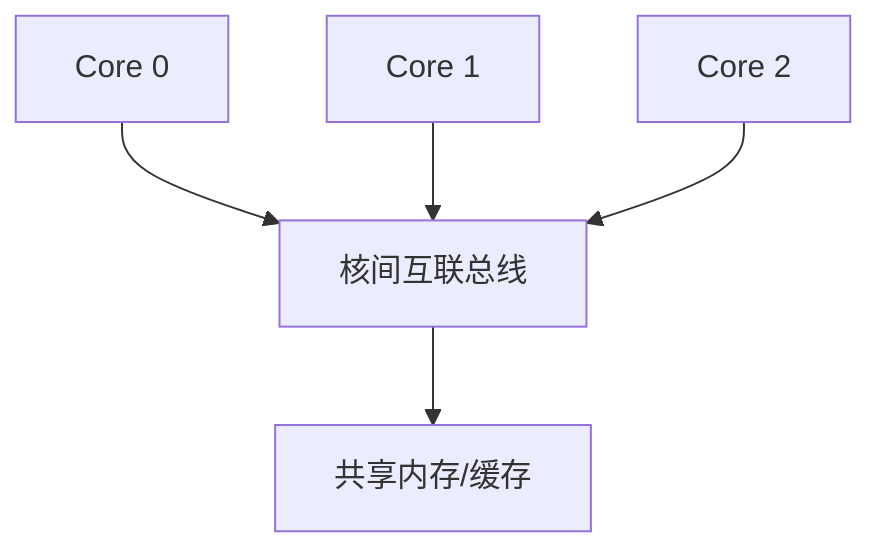

# 配置方法

rv32c 的全部可配置项集中在两层模型：**ISA 配置**（`rv32c.isa` 包：指令集三条轴 xlen × 扩展 × 特权栈）与 **核配置** `CoreConfig`（微架构与平台旋钮）。修改参数后重新生成 RTL / 重新编译仿真即可，核心内部代码无需改动。

## 配置模型分层

| 层 | 类型 | 职责 | 单一事实源 |
|----|------|------|-----------|
| ISA | `rv32c.isa.IsaConfig` | 位宽、扩展、特权栈 | misa 值、`hasMulDiv` 等能力探测、规范名 |
| 扩展 | `rv32c.isa.RvExtension` | 命名扩展（M/A/C/F/D/Zba/Zbb/Zbs/Zbc/Zbkb/Zbkc/Zbkx/Zknh/Zksh/Zksed/Zknd/Zkne/Zicond/Zcb/Zicsr/Zifencei/Zicntr） | `implemented`（当前 RTL 可执行）vs `reserved`（roadmap） |
| 特权 | `rv32c.isa.PrivConfig` | 特权栈形状（M/M-U/M-S-U） | `hasUser/hasSupervisor/hasHypervisor`、栈名 |
| CSR | `rv32c.isa.CsrMap` | CSR 地址、只读性、最低特权 | `implementedFor(isa)` / `readOnlyFor(isa)`，供 CSR 读解码与 EX 合法性检查共用 |
| 异常码 | `rv32c.isa.ExceptionCode` | `mcause` 同步异常编号 | 具名常量（2/3/4/6/8/9/11），消除 trap 通路魔法数字 |
| 核 | `CoreConfig` | 复位向量、预测器/缓存占位、多核、调试 | 组合 `IsaConfig`，转发 `xlen/misaValue/hasMulDiv/hasAtomic/hasFpu/flen` |

> 译码器 `Decoder` 与 CSR 文件 `CsrFile` 均接收 `IsaConfig`：M 扩展使能、misa 值等不再以散布尔/常量参数传入，而由配置层派生。EX 级 CSR 合法集（已实现地址、只读地址）来自 `CsrMap`，不再硬编码地址链。特权模式合法性同样配置驱动：`PrivConfig.supportedEncodings` 决定哪些 `MPP`/模式编码合法，`privAtLeast(minPriv)` 决定 CSR 访问权限；当 M/U 栈扩展为 M/S/U 时无需改写判定结构。

## ISA 配置（`IsaConfig`）

```scala
case class IsaConfig(
    xlen: Int = 32,                                            // 32 (RV32I) 或 64 (RV64I)，"I" 隐含
    extensions: Set[RvExtension] = Set(RvExtension.Zicsr),     // 使能的扩展
    priv: PrivConfig = PrivConfig.MU                           // 特权栈
)
```

| 字段 | 默认值 | 说明 |
|------|--------|------|
| `xlen` | 32 | 数据路径位宽，`isa-support` 以配置为准生成 |
| `extensions` | `{Zicsr}` | `RvExtension.MulDiv`（M）、`Atomic`（A）、`SingleFloat`（F，FLEN=32）、`DoubleFloat`（D，FLEN=64，仅 RV64 且蕴含 F）、`Compressed`（C，RV32 与 RV64 均支持）、`Zba`/`Zbb`/`Zbs`/`Zbc`/`Zbkb`/`Zbkc`/`Zbkx`/`Zknh`/`Zksh`/`Zksed`/`Zknd`/`Zkne`/`Zicond`/`Zcb`（位操作、条件运算与附加压缩指令，RV32 与 RV64 均支持，无 MISA 位）；`Zicsr`、`Zifencei` 与 `Zicntr` 同为 `implemented`，`reserved` 当前为空 |
| `priv` | `M/U` | 结构规则由 `PrivConfig` 强制：M 必选、S 蕴含 U、H 蕴含 S；S/H 为 RV64 专用（当前 RTL 仅实现 M/U） |

### 预设

```scala
IsaConfig.rv32    // RV32I_Zicsr,   M/U   —— 默认 RV32 MCU 基线
IsaConfig.rv32im  // RV32IM_Zicsr,  M/U   —— 含乘除扩展
IsaConfig.rv32imc // RV32IMC_Zicsr, M/U   —— 含乘除与 RV32C 压缩扩展
IsaConfig.rv64imc // RV64IMC_Zicsr, M/U   —— 含乘除与 RV64C 压缩扩展
IsaConfig.rv32ima // RV32IMA_Zicsr, M/U   —— 含乘除与 RV32A 原子扩展
IsaConfig.rv64ima // RV64IMA_Zicsr, M/U   —— 含乘除与 RV64A 原子扩展
IsaConfig.rv32f   // RV32F_Zicsr,   M/U   —— 含单精度浮点扩展（FLEN=32）
IsaConfig.rv64f   // RV64F_Zicsr,   M/U   —— RV64 单精度浮点扩展（FLEN=32）
IsaConfig.rv64d   // RV64D_Zicsr,   M/U   —— RV64 双精度浮点扩展（FLEN=64，蕴含 F）
IsaConfig.rv32imzbb // RV32IM_Zbb_Zicsr, M/U —— 含 Zbb 基础位操作扩展
IsaConfig.rv64imzbb // RV64IM_Zbb_Zicsr, M/U —— RV64 含 Zbb 基础位操作扩展
IsaConfig.rv32imzbs // RV32IM_Zbs_Zicsr, M/U —— 含 Zbs 单比特操作扩展
IsaConfig.rv64imzbs // RV64IM_Zbs_Zicsr, M/U —— RV64 含 Zbs 单比特操作扩展
IsaConfig.rv32imzba // RV32IM_Zba_Zicsr, M/U —— 含 Zba 地址生成扩展
IsaConfig.rv64imzba // RV64IM_Zba_Zicsr, M/U —— RV64 含 Zba 地址生成扩展
IsaConfig.rv32imzbc // RV32IM_Zbc_Zicsr, M/U —— 含 Zbc 无进位乘法扩展
IsaConfig.rv64imzbc // RV64IM_Zbc_Zicsr, M/U —— RV64 含 Zbc 无进位乘法扩展
IsaConfig.rv32imzbkb // RV32IM_Zbkb_Zicsr, M/U —— 含 Zbkb 密码学位操作扩展
IsaConfig.rv64imzbkb // RV64IM_Zbkb_Zicsr, M/U —— RV64 含 Zbkb 密码学位操作扩展
IsaConfig.rv32imzbkc // RV32IM_Zbkc_Zicsr, M/U —— 含 Zbkc 无进位乘法子集
IsaConfig.rv64imzbkc // RV64IM_Zbkc_Zicsr, M/U —— RV64 含 Zbkc 无进位乘法子集
IsaConfig.rv32imzbkx // RV32IM_Zbkx_Zicsr, M/U —— 含 Zbkx 交叉位置换扩展
IsaConfig.rv64imzbkx // RV64IM_Zbkx_Zicsr, M/U —— RV64 含 Zbkx 交叉位置换扩展
IsaConfig.rv32imzbk  // RV32IM_Zbkb_Zbkc_Zbkx_Zicsr, M/U —— 组合密码学位操作集
IsaConfig.rv64imzbk  // RV64IM_Zbkb_Zbkc_Zbkx_Zicsr, M/U —— RV64 组合密码学位操作集
IsaConfig.rv32imzknh // RV32IM_Zicsr_Zknh, M/U —— 含 Zknh SHA-2 哈希位操作扩展
IsaConfig.rv64imzknh // RV64IM_Zicsr_Zknh, M/U —— RV64 含 Zknh SHA-2 哈希位操作扩展
IsaConfig.rv32imzksh // RV32IM_Zicsr_Zksh, M/U —— 含 Zksh SM3 哈希位操作扩展
IsaConfig.rv64imzksh // RV64IM_Zicsr_Zksh, M/U —— RV64 含 Zksh SM3 哈希位操作扩展
IsaConfig.rv32imzksed // RV32IM_Zicsr_Zksed, M/U —— 含 Zksed SM4 变换扩展
IsaConfig.rv64imzksed // RV64IM_Zicsr_Zksed, M/U —— RV64 含 Zksed SM4 变换扩展
IsaConfig.rv32imzks  // RV32IM_Zicsr_Zksed_Zksh, M/U —— 组合 Zksh + Zksed
IsaConfig.rv64imzks  // RV64IM_Zicsr_Zksed_Zksh, M/U —— RV64 组合 Zksh + Zksed
IsaConfig.rv32imzkne // RV32IM_Zicsr_Zkne, M/U —— 含 Zkne AES 加密轮变换扩展
IsaConfig.rv64imzkne // RV64IM_Zicsr_Zkne, M/U —— RV64 含 Zkne AES 加密轮变换扩展
IsaConfig.rv32imzknd // RV32IM_Zicsr_Zknd, M/U —— 含 Zknd AES 解密轮变换扩展
IsaConfig.rv64imzknd // RV64IM_Zicsr_Zknd, M/U —— RV64 含 Zknd AES 解密轮变换扩展
IsaConfig.rv32imzkn  // RV32IM_Zicsr_Zknd_Zkne, M/U —— 组合 Zkne + Zknd
IsaConfig.rv64imzkn  // RV64IM_Zicsr_Zknd_Zkne, M/U —— RV64 组合 Zkne + Zknd
IsaConfig.rv32imzicond // RV32IM_Zicond_Zicsr, M/U —— 含 Zicond 条件运算扩展
IsaConfig.rv64imzicond // RV64IM_Zicond_Zicsr, M/U —— RV64 含 Zicond 条件运算扩展
IsaConfig.rv32imzcb     // RV32IMC_Zbb_Zcb_Zicsr, M/U —— 含 Zcb 附加压缩扩展
IsaConfig.rv64imzcb     // RV64IMC_Zba_Zbb_Zcb_Zicsr, M/U —— RV64 含 Zcb 附加压缩扩展
IsaConfig.rv32imzifencei // RV32IM_Zicsr_Zifencei, M/U —— 含 fence.i 指令流同步
IsaConfig.rv64imzifencei // RV64IM_Zicsr_Zifencei, M/U —— RV64 含 fence.i 指令流同步
IsaConfig.rv32imzicntr  // RV32IM_Zicsr_Zicntr  , M/U —— 含 cycle/time/instret 与 mcounteren
IsaConfig.rv64imzicntr  // RV64IM_Zicsr_Zicntr  , M/U —— RV64 版用户计数器
IsaConfig.rv32imsu // RV32IM_Zicsr, M/S/U —— 含 S 级 CSR、异常/中断委托与 SRET
IsaConfig.rv64imsu // RV64IM_Zicsr, M/S/U —— RV64 含 S 模式
IsaConfig.rv64    // RV64I_Zicsr,   M/S/U —— RV64I 基线（含 S 模式）
```

**misa 从配置推导**：`misaValue = MXL | I | (U/S 位按特权栈) | 扩展字母位`。默认 RV32 配置得 `0x40100100`（I/U，无 M），`rv32im` 得 `0x40101100`，`rv32imc` 额外置 C 位，`rv32ima` 额外置 A 位（`0x40101101`）；`rv64imc` 得 `MXL=2` 并置 I/M/C/U 位，`rv64ima` 得 `MXL=2` 并置 I/M/A/U 位，`rv32f` 置 F 位，`rv64d` 同时置 F 与 D 位。`Zba`/`Zbb`/`Zbs`/`Zbc`/`Zbkb`/`Zbkc`/`Zbkx`/`Zknh`/`Zksh`/`Zksed`/`Zknd`/`Zkne`/`Zicond`/`Zcb`/`Zifencei`/`Zicntr` 为无名 MISA 位的命名扩展，不改变 `misaValue`（规范保留单字母 `B` 位）。S 模式是特权栈属性：`rv32imsu`/`rv64imsu` 会在 `misa` 中置 S 位。

## CoreConfig 字段

```scala
case class CoreConfig(
    isa: IsaConfig = IsaConfig.rv32,               // ISA 三轴（单一事实源）
    resetVector: BigInt = 0x00000000L,             // 复位后 PC 初始值
    branchPredictor: BranchPredictorConfig = ...,  // 分支预测器配置
    withICache: Option[CacheConfig] = None,        // 指令缓存
    withDCache: Option[CacheConfig] = None,        // 数据缓存
    numCores: Int = 1,                             // 处理器核数量
    hartId: Int = 0,                               // 硬件线程 ID
    withDebug: Boolean = false                     // 导出调试信号（寄存器堆）
)
```

| 字段 | 默认值 | 说明 |
|------|--------|------|
| `isa` | `IsaConfig.rv32` | ISA 三轴。`CoreConfig` 转发 `xlen/isRV64/hasMulDiv/hasAtomic/hasFpu/flen/misaValue/priv` |
| `resetVector` | 0x00000000 | 上电后 PC 起始地址，常见 SoC 用 0x80000000 |
| `branchPredictor` | staticNotTaken | 预留：当前固定"不跳转"预测，可换 BHT/gshare |
| `withICache/DCache` | None | 预留：在总线接口后插入缓存 |
| `numCores` | 1 | 多核数量，为核间互联保留 |
| `hartId` | 0 | 每个核的硬件线程 ID（多核时用于 CSR 等） |
| `withDebug` | false | 仿真观测预留。当前 `RiscvCore` 始终导出 `debugPc/debugRegs/debugMepc/debugMcause/debugMode` 到顶层；该开关保留用于后续按需裁减调试逻辑 |

## 使用示例

### 标准 RV32IM 单核（含乘除扩展）

```scala
val config = CoreConfig.rv32im        // isa = IsaConfig.rv32im
SpinalConfig().generateVerilog(new RiscvCore(config))
```

### 默认纯 RV32I（无 M）

```scala
val config = CoreConfig()             // isa 默认 RV32I_Zicsr, M/U
```

`RiscvCoreGen` 生成四十八个配置：`rtl/RiscvCore.v`（`CoreConfig.rv32im`，C 关闭）、`rtl/RiscvCoreC.v`（`CoreConfig.rv32imc`，C 使能）、`rtl/RiscvCore64C.v`（`CoreConfig.rv64imc`，RV64C）、`rtl/RiscvCoreA.v`（`CoreConfig.rv32ima`，RV32A）、`rtl/RiscvCore64A.v`（`CoreConfig.rv64ima`，RV64A）、`rtl/RiscvCoreF.v`（`CoreConfig.rv32f`，RV32F）、`rtl/RiscvCore64F.v`（`CoreConfig.rv64f`，RV64F）、`rtl/RiscvCore64D.v`（`CoreConfig.rv64d`，RV64D）、`rtl/RiscvCoreB.v`/`rtl/RiscvCore64B.v`（`CoreConfig.rv32imzbb`/`rv64imzbb`，Zbb）、`rtl/RiscvCoreBS.v`/`rtl/RiscvCore64BS.v`（`CoreConfig.rv32imzbs`/`rv64imzbs`，Zbs）、`rtl/RiscvCoreBA.v`/`rtl/RiscvCore64BA.v`（`CoreConfig.rv32imzba`/`rv64imzba`，Zba）、`rtl/RiscvCoreBC.v`/`rtl/RiscvCore64BC.v`（`CoreConfig.rv32imzbc`/`rv64imzbc`，Zbc）、`rtl/RiscvCoreBKB.v`/`rtl/RiscvCore64BKB.v`（`CoreConfig.rv32imzbkb`/`rv64imzbkb`，Zbkb）、`rtl/RiscvCoreBKC.v`/`rtl/RiscvCore64BKC.v`（`CoreConfig.rv32imzbkc`/`rv64imzbkc`，Zbkc）、`rtl/RiscvCoreBKX.v`/`rtl/RiscvCore64BKX.v`（`CoreConfig.rv32imzbkx`/`rv64imzbkx`，Zbkx）、`rtl/RiscvCoreBK.v`/`rtl/RiscvCore64BK.v`（`CoreConfig.rv32imzbk`/`rv64imzbk`，Zbkb+Zbkc+Zbkx）、`rtl/RiscvCoreKNH.v`/`rtl/RiscvCore64KNH.v`（`CoreConfig.rv32imzknh`/`rv64imzknh`，Zknh）、`rtl/RiscvCoreKSH.v`/`rtl/RiscvCore64KSH.v`（`CoreConfig.rv32imzksh`/`rv64imzksh`，Zksh）、`rtl/RiscvCoreKSED.v`/`rtl/RiscvCore64KSED.v`（`CoreConfig.rv32imzksed`/`rv64imzksed`，Zksed）、`rtl/RiscvCoreKS.v`/`rtl/RiscvCore64KS.v`（`CoreConfig.rv32imzks`/`rv64imzks`，Zksh+Zksed）、`rtl/RiscvCoreKNE.v`/`rtl/RiscvCore64KNE.v`（`CoreConfig.rv32imzkne`/`rv64imzkne`，Zkne）、`rtl/RiscvCoreKND.v`/`rtl/RiscvCore64KND.v`（`CoreConfig.rv32imzknd`/`rv64imzknd`，Zknd）、`rtl/RiscvCoreKN.v`/`rtl/RiscvCore64KN.v`（`CoreConfig.rv32imzkn`/`rv64imzkn`，Zknd+Zkne）、`rtl/RiscvCoreZICOND.v`/`rtl/RiscvCore64ZICOND.v`（`CoreConfig.rv32imzicond`/`rv64imzicond`，Zicond）、`rtl/RiscvCoreZCB.v`/`rtl/RiscvCore64ZCB.v`（`CoreConfig.rv32imzcb`/`rv64imzcb`，Zbb+Zcb / Zba+Zbb+Zcb）与 `rtl/RiscvCoreZIFENCEI.v`/`rtl/RiscvCore64ZIFENCEI.v`（`CoreConfig.rv32imzifencei`/`rv64imzifencei`，Zifencei）、`rtl/RiscvCoreZICNTR.v`/`rtl/RiscvCore64ZICNTR.v`（`CoreConfig.rv32imzicntr`/`rv64imzicntr`，Zicntr），以及 `rtl/RiscvCoreS.v`/`rtl/RiscvCore64S.v`（`CoreConfig.rv32imsu`/`rv64imsu`，M/S/U），均 `withDebug = true`。`./scripts/gen-rtl.sh` 会同时生成。

### 启用 RV32C 压缩扩展（RV32IMC）

```scala
val config = CoreConfig.rv32imc       // isa = IsaConfig.rv32imc
```

压缩取指仅在 `isa.hasCompressed` 时生成；默认配置不含 C，取指与译码逐拍保持原行为。

### 启用 RV64C 压缩扩展（RV64IMC）

```scala
val config = CoreConfig.rv64imc       // isa = IsaConfig.rv64imc
```

RV32 与 RV64 共用同一压缩取指通路（2 字节 PC 粒度、`pc[1]` 半字选择、`mis32` 拼接），译码按 `xlen` 展开专属编码：RV64 支持 `C.LD/C.SD`、`C.LDSP/C.SDSP`、`C.ADDIW`、`C.SUBW/C.ADDW` 与 6 位 shamt 的压缩移位；RV32 专属的 `C.JAL` 在 RV64 上置 illegal，反之 RV64 专属编码在 RV32 上置 illegal。

### 启用 RV32A / RV64A 原子扩展

```scala
val config = CoreConfig.rv32ima       // isa = IsaConfig.rv32ima
val config64 = CoreConfig.rv64ima     // isa = IsaConfig.rv64ima
```

原子通路仅在 `isa.hasAtomic` 时生成；默认配置不含 A，访存与转发逐拍保持原行为。AMO 的「读→改→写」在 MEM 级以两态状态机完成并冻结流水线，LR/SC 预约集在内核内维护；A 关闭时该分支连同 `reserved`、状态机全部被剪除。

### 启用 RV32F / RV64F 浮点扩展

```scala
val config = CoreConfig.rv32f        // isa = IsaConfig.rv32f, FLEN=32
val config64 = CoreConfig.rv64f      // isa = IsaConfig.rv64f, FLEN=32
```

浮点通路仅在 `isa.hasFpu` 时生成：独立的浮点寄存器堆、FLW/FSW 访存、EX 段参数化 IEEE-754 运算单元（`FpUnit(expw, sigw)`，F 为 `(8, 23)`）。FPU 为组合逻辑 + 单冻结周期，复用与乘除器相同的统一 `freezeAll` 机制，FP 结果只有 WB 级转发。启用 F 后 `fcsr`/`fflags`/`frm` CSR 生效，`mstatus.FS` 按指令提交置 Dirty；FS=Off 时 FP 指令与 fcsr 访问触发 illegal（cause 2）。

### 启用 RV64D 双精度浮点扩展

```scala
val config = CoreConfig.rv64d        // isa = IsaConfig.rv64d, FLEN=64，蕴含 F
```

D 核同时实例化 `FpUnit(8, 23)`（binary32）与 `FpUnit(11, 52)`（binary64）两个运算单元，按指令 fmt 路由：`.S` 指令走 32 位单元、`.D` 指令走 64 位单元，避免把单精度操作数宽化后再舍入造成的双重舍入。`FCVT.S.D` / `FCVT.D.S` 在 64 位单元上执行（`roundPackTo` 支持任意目标格式）。FLEN=64 下启用 NaN-boxing：单精度写回结果高 32 位置 1，非 boxed 的单精度输入按规范 NaN（`0x7FC00000`）处理。D 蕴含 F，且仅在 `xlen = 64` 时合法，RV32 配置 D 会在 `IsaConfig` 构造时被 require 拒绝。

### 启用 Zba / Zbb / Zbs / Zbc、Zbkb / Zbkc / Zbkx、Zknh / Zksh / Zksed、Zknd / Zkne、Zicond、Zcb、Zifencei 与 Zicntr 扩展

```scala
val config = CoreConfig.rv32imzbb     // isa = IsaConfig.rv32imzbb, 含 Zbb
val config64 = CoreConfig.rv64imzba   // isa = IsaConfig.rv64imzba, 含 Zba
val configClmul = CoreConfig.rv64imzbc // isa = IsaConfig.rv64imzbc, 含 Zbc
val configCrypto = CoreConfig.rv32imzbk // isa = IsaConfig.rv32imzbk, 含 Zbkb+Zbkc+Zbkx
val configSha = CoreConfig.rv64imzknh // isa = IsaConfig.rv64imzknh, 含 Zknh
val configSm3 = CoreConfig.rv32imzksh  // isa = IsaConfig.rv32imzksh, 含 Zksh
val configSm4 = CoreConfig.rv64imzksed // isa = IsaConfig.rv64imzksed, 含 Zksed
val configSm = CoreConfig.rv32imzks   // isa = IsaConfig.rv32imzks, 含 Zksh+Zksed
val configAesEnc = CoreConfig.rv64imzkne // isa = IsaConfig.rv64imzkne, 含 Zkne
val configAesDec = CoreConfig.rv32imzknd // isa = IsaConfig.rv32imzknd, 含 Zknd
val configAes = CoreConfig.rv64imzkn   // isa = IsaConfig.rv64imzkn, 含 Zkne+Zknd
val configCond = CoreConfig.rv32imzicond // isa = IsaConfig.rv32imzicond, 含 Zicond
val configZcb  = CoreConfig.rv32imzcb    // isa = IsaConfig.rv32imzcb, 含 C + Zbb + Zcb
val configFence = CoreConfig.rv32imzifencei // isa = IsaConfig.rv32imzifencei, 含 Zifencei
```

`Zb*`、`Zknh`、`Zk*` 与 `Zicond` 彼此独立、按需使能，位操作通路仅在对应 `isa.hasZbb` / `hasZbs` / `hasZba` / `hasZbc` / `hasZbkb` / `hasZbkc` / `hasZbkx` / `hasZknh` / `hasZksh` / `hasZksed` / `hasZknd` / `hasZkne` / `hasZicond` / `hasZcb` / `hasZifencei` 时译码，未使能时相应编码按非法指令（cause 2）处理。Zbb 提供 `andn/orn/xnor`、`clz/ctz/cpop`、`min/minu/max/maxu`、`rol/ror/rori`、`sext.b/sext.h/zext.h`、`orc.b/rev8` 及 RV64 W 形式；Zbs 提供 `bset/bclr/binv/bext` 寄存器与立即数形式（RV32 5 位 / RV64 6 位位索引）；Zba 提供 `sh1add/sh2add/sh3add` 与 RV64 `add.uw/slli.uw/sh*add.uw`；Zbc 提供 `clmul/clmulh/clmulr` 无进位乘法；Zbkb 提供 `pack/packh/packw`、`brev8` 与 RV32 `zip/unzip`；Zbkc 提供 `clmul/clmulh`（Zbc 的无 `clmulr` 子集，与 Zbc 共用 `clmul/clmulh` 编码）；Zbkx 提供 `xperm4/xperm8` 交叉位置换；Zknh 提供 SHA-2 变换 `sha256sum0/sum1/sig0/sig1`、RV64 `sha512sum0/sum1/sig0/sig1` 与 RV32 拆分形式 `sha512sum0r/sum1r/sig0l/sig0h/sig1l/sig1h`；Zksh 提供 SM3 变换 `sm3p0/sm3p1`；Zksed 提供 SM4 变换 `sm4ed/sm4ks`（支持全部 4 种字节选择 `bs`）；Zkne 提供 AES 加密轮变换 `aes32esi/aes32esmi`（RV32）与 `aes64es/aes64esm`（RV64）；Zknd 提供 AES 解密轮变换 `aes32dsi/aes32dsmi`（RV32）与 `aes64ds/aes64dsm/aes64im`（RV64），两者共用 RV64 密钥调度 `aes64ks1i/aes64ks2`；Zicond 提供 `czero.eqz/czero.nez` 条件零运算；Zcb 提供压缩字节/半字访存 `c.lbu/c.lhu/c.lh/c.sb/c.sh` 与压缩寄存器运算 `c.zext.b/c.sext.b/c.zext.h/c.sext.h/c.zext.w/c.not/c.mul`（`c.sext.*/c.zext.h` 需 Zbb，`c.zext.w` 需 RV64+Zba，`c.mul` 需 M）；Zifencei 提供 `fence.i` 指令流同步（无 I 缓存，作为合法提交点）；Zicntr 提供 `cycle/time/instret` 与 `mcycle/minstret`（RV32 含高半字）、`mcounteren/scounteren`，`cycle` 每拍自增、`instret` 在 WB 提交点累加。Zb*/Zk*/Zicond/Zcb/Zifencei 在 EX 段组合执行，复用现有 ALU 结果通路，无新增停顿状态。上述所有 `Zb*`、`Zknh`、`Zk*`、`Zicond`、`Zcb`、`Zifencei` 与 `Zicntr` 均不置 MISA `B` 位，`rv32imzbb` 的 `misaValue` 与 `rv32im` 相同。

### 切换到 RV64IM（M/U 栈）

```scala
val config = CoreConfig(isa = IsaConfig(64, Set(RvExtension.Zicsr, RvExtension.MulDiv), PrivConfig.MU))
```

数据路径、地址、立即数、寄存器堆与访存宽度均按 `isa.xlen` 生成；指令宽度仍是 32 位。RV64 下支持 `*W` 后缀（含 RV64M 的 `MULW/DIVW/DIVUW/REMW/REMUW`）、64 位移位与 `LD/LWU/SD`。

### 启用 S 模式（M/S/U 特权栈）

```scala
// 推荐使用预置：
val config = CoreConfig.rv32imsu      // RV32IM_Zicsr，M/S/U
val config64 = CoreConfig.rv64imsu    // RV64IM_Zicsr，M/S/U

// 也可自行组合：特权栈是 IsaConfig 的第三维
val custom = CoreConfig(isa = IsaConfig(64, Set(RvExtension.Zicsr), PrivConfig.MSU))
```

S 栈下额外实现 `medeleg/mideleg` 与 S 级 CSR，`misa` 自动置 S 位；`satp` 仅支持 BARE 翻译模式。

### 多核配置（预留）

```scala
val config = CoreConfig(numCores = 4, hartId = 0)
```

当前版本 `RiscvCore` 是单核组件；`numCores` 与 `hartId` 为多核组合预留。多核 SoC 结构：



## 能力校验（RTL 实例化时）

`RiscvCore` 构造时把 `CoreConfig` 与当前 RTL 能力对齐，超范围配置在 elaboration 期即报错：

- 支持：RV32I / RV64I（M/U 栈，或 M/S/U 栈的 `rv32imsu`/`rv64imsu`），扩展限定在 `RvExtension.implemented`（M、A、F、Zicsr、C、Zba、Zbb、Zbs、Zbc、Zbkb、Zbkc、Zbkx、Zknh、Zksh、Zksed、Zknd、Zkne、Zicond、Zcb、Zifencei、Zicntr；D 仅 RV64）；RV64 下 M 扩展按 W 后缀形式实现，A 扩展 RV32 与 RV64 均支持（`.W` / `.D`），C 扩展 RV32 与 RV64 均支持，F/D 由参数化 FPU（`expw/sigw`）承载，Zba/Zbb/Zbs/Zbc/Zbkb/Zbkc/Zbkx/Zknh/Zksh/Zksed/Zknd/Zkne/Zicond/Zcb/Zifencei 由参数化 ALU 承载，Zicntr 由 `CsrFile` 计数器承载（RV64 W 形式按 `xlen` 展开）
- 拒绝：S/H 模式、RV32 上的 D、无 Zicsr、纯 M（无 U）
- 被拒绝的是"当前 RTL 尚未实现"，而非"配置模型表达不了"——结构与能力分离

## 参数传递原则

- 配置采用**单点注入**：`CoreConfig` 传入 `RiscvCore`，逐层传给各子模块（ALU、寄存器堆、译码器）
- 一切与指令/CSR/模式相关的位宽与能力均来自 `config.isa`（经 `CoreConfig` 转发），保证全链路一致
- S/H 模式、缓存、分支预测器通过 `reserved` 集合与配置旋钮 + 文档说明预留，避免死代码进入 RTL
